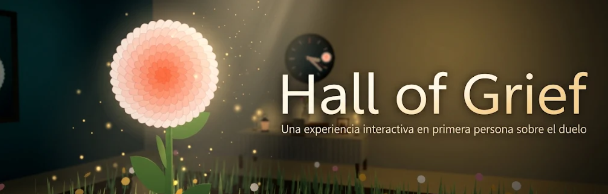

# Hall of Grief

> *Un entorno virtual interactivo en primera persona sobre las etapas psicológicas del duelo, basado en el modelo de Elisabeth Kübler-Ross.*

**Hall of Grief** es un proyecto desarrollado para la cátedra de **Creatividad y Desarrollo de Entornos Virtuales (5K4)** de la **Universidad Tecnológica Nacional – Facultad Regional Córdoba (UTN-FRC)** por el **Grupo 9** (2026).

---

## Acerca del proyecto

En lugar de explicar el duelo mediante textos largos o mecánicas de habilidad, *Hall of Grief* utiliza **narrativa ambiental** (*show, don't tell*): el espacio, la luz, el color y el sonido cambian en función de cada etapa emocional. No existe condición de derrota ni límite de tiempo; cada habitación se atraviesa mediante un cambio de actitud frente a lo que ocurre.

> **Aviso de contenido sensible:** La experiencia aborda temáticas vinculadas al duelo y la pérdida. En cualquier momento se puede presionar `Esc` para pausar, regular el volumen, silenciar el audio o reiniciar el recorrido.

---

## Características principales

* **Pasillo infinito y evolutivo:** Implementado con un patrón *treadmill* de 7 segmentos que se reciclan dinámicamente con puertas aleatorias a ambos lados. El pasillo atraviesa **4 estados visuales y sonoros** a medida que se completan habitaciones, pasando de un entorno frío con fluorescentes parpadeantes a un espacio cálido y armónico.
* **Progresión no lineal:** Para reflejar que el duelo no es igual ni lineal para todas las personas, cada partida sortea el orden de las etapas previas y define un recorrido manteniendo siempre **Aceptación** como cierre.
* **Cinco etapas interactivas:**
  * **Negación:** Sala doméstica en tonos verde azulado donde el usuario debe dejar de mirar hacia otro lado y atender 3 anomalías (reloj detenido en las 3:17:41, cajón entreabierto y cuadro torcido de la dalia).
  * **Ira:** Habitación rojiza con mandatos sociales que se deforma físicamente (de 6 m a 29 m). Propone canalizar la rabia destruyendo los objetos marcados sin dañar los recuerdos cálidos.
  * **Negociación:** Cuarto ámbar con papeles flotantes y un reloj que gira hacia atrás. Cada intento de "negociar" con la puerta comprime la sala hasta que el usuario suelta los objetos sobre la mesa central.
  * **Depresión:** Camino exterior oscuro de 100 m bajo la lluvia con muebles semienterrados, siluetas con *glitch* y un reloj gigante. En la oscuridad el paso se vuelve pesado, mientras que cada farol actúa como refugio para descansar y recuperar el ritmo.
  * **Aceptación:** Jardín interior luminoso donde se arma un memorial dinámico con los recuerdos traídos de las salas recorridas, se ofrece una tarjeta editable opcional y se planta y riega una semilla de dalia antes de salir al prado exterior.
* **Audio 100 % procedural:** Todo el paisaje sonoro (ambientes, disonancias, impactos, lluvia, capas armónicas y reverberación) se sintetiza en tiempo real mediante la **Web Audio API**, sin archivos de audio externos.
* **Sin assets pesados:** Superficies y detalles generados proceduralmente con `THREE.CanvasTexture`, efectos atmosféricos programados en **GLSL** (`ShaderMaterial`) y optimización mediante `InstancedMesh`.

---

## Controles

| Acción | Control |
| :--- | :--- |
| **Moverse** | `W` `A` `S` `D` |
| **Mirar** | `Mouse` *(Pointer Lock)* |
| **Interactuar** | `Click izquierdo` o tecla `E` |
| **Pausa / Opciones de audio / Reiniciar** | `Esc` |

---

## Stack tecnológico

* **Motor 3D:** [Three.js](https://threejs.org/) (`v0.160`, vanilla WebGL)
* **Lenguaje y módulos:** JavaScript (ES6 Modules)
* **Empaquetador y servidor de desarrollo:** [Vite](https://vitejs.dev/) (`v5`)
* **Audio:** [Web Audio API](https://developer.mozilla.org/en-US/docs/Web/API/Web_Audio_API) 
* **Shaders:** GLSL (`ShaderMaterial` personalizados)
* **Interfaz:** HTML5 y CSS3 superpuestos al canvas tridimensional

---

## Instalación y ejecución local

### Requisitos previos
* [Node.js](https://nodejs.org/) (v18 o superior recomendada)
* `npm`

### Pasos

1. Clonar el repositorio:
   ```bash
   git clone <https://github.com/rodrfrias/HallOfGrief>
   cd <HallOfGrief>
   ```

2. Instalar las dependencias:
   ```bash
   npm install
   ```

3. Iniciar el servidor de desarrollo:
   ```bash
   npm run dev
   ```

4. Abrir en el navegador la URL local indicada por Vite (por defecto `http://localhost:5173`).

---

## Equipo – Grupo 9 (5K4 – UTN-FRC)

* **Abel Baharona** – Lead Programmer · Engine Programmer
* **Rodrigo Frias** – Game Designer · Level Designer
* **Emanuel Oroná** – Producer · Art Director · Technical Artist
* **Facundo Pellejero** – Gameplay Programmer · Engine Programmer · UI Programmer · World Builder
* **Felipe Ferrer** – AI Programmer · UX Designer
* **Francisco Sánchez** – Audio Director · Sound Designer
* **Nicolás Cugno** – Narrative Director · World Builder
* **Ignacio Prado** – Game Designer · Level Designer · Narrative Director · World Builder


---

## Referencias principales

* Kübler-Ross, E. (1969). *On Death and Dying*. Macmillan.
* Murray, J. H. (2017). *Hamlet on the Holodeck: The Future of Narrative in Cyberspace*. The MIT Press.
* Jenkins, H. (2004). *Game Design as Narrative Architecture*. MIT Press.
* Csikszentmihalyi, M. (1990). *Flow: The Psychology of Optimal Experience*. Harper & Row.